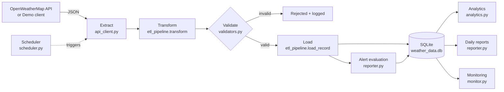

# Architecture

## Data flow

## Modules

| Module | Responsibility |
|--------|----------------|
| `config.py` | Loads `settings.json`, `cities.json`, `.env`; configures logging |
| `database.py` | Connections (commit/rollback), schema creation, insert helpers, run log |
| `api_client.py` | HTTP calls, retries with backoff, error classification, key redaction, demo client |
| `etl_pipeline.py` | Orchestrates one ETL cycle; isolates failures per city |
| `validators.py` | Per-record validation and database-wide quality metrics |
| `analytics.py` | SQL + pandas queries for historical analysis |
| `reporter.py` | Alert rules and daily report generation (TXT + CSV) |
| `monitor.py` | Health status logic and dashboard rendering |
| `scheduler.py` | Interval loop that survives job failures |

## Error handling

| Failure | Behaviour |
|---------|-----------|
| Timeout / connection error / HTTP 429 / 5xx | Retried up to `max_retries` with increasing backoff |
| HTTP 401 (bad key) / 404 (unknown city) | Not retried; recorded as an error for that city |
| Malformed payload | `TransformError`; city rejected, run continues |
| Value out of range / missing field | Record rejected and logged; never reaches the database |
| Duplicate observation | Silently skipped (counted as `duplicates`) |
| Unexpected exception | Logged with traceback; run continues with the next city |

Run status: `SUCCESS` (all cities ok), `PARTIAL` (some failed), `FAILED` (nothing loaded).

## Health status rules

- **CRITICAL**: pipeline never ran, last run `FAILED`, or quality checks found bad data
- **WARNING**: last run `PARTIAL`, or no run for longer than `stale_after_minutes`
- **HEALTHY**: otherwise
