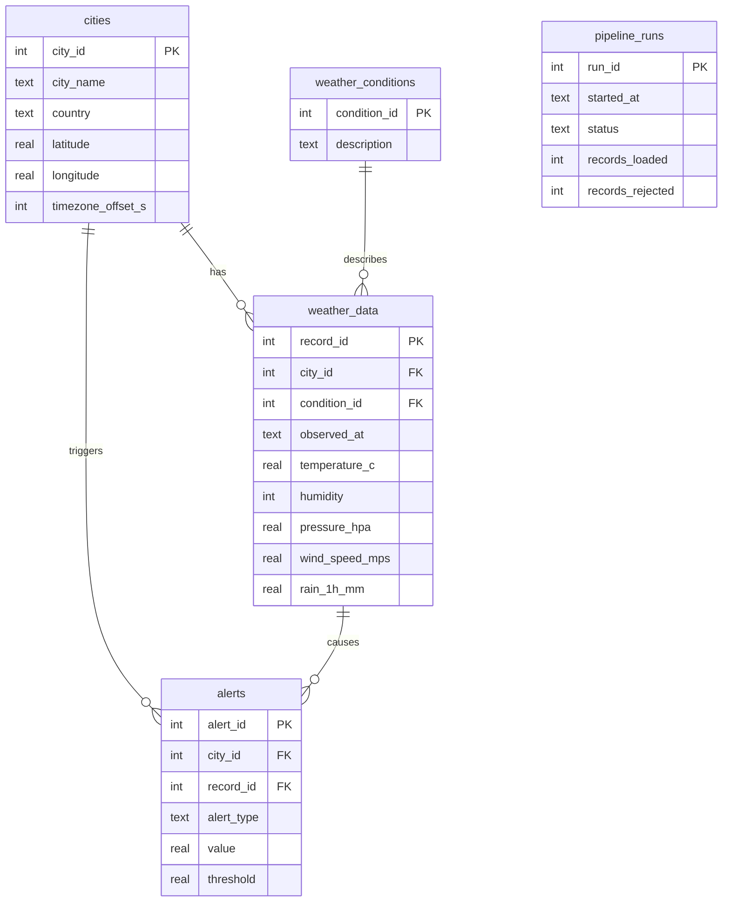

# Data dictionary

All timestamps are UTC, formatted `YYYY-MM-DD HH:MM:SS`.

## Tables

**cities**: one row per tracked city. `UNIQUE(city_name, country)`. `timezone_offset_s` is the
offset from UTC in seconds (used to compute local hour).

**weather_conditions**: lookup of condition descriptions (e.g. "clear sky"), so the text is
stored once.

**weather_data**: one row per observation. `UNIQUE(city_id, observed_at)`.

| Column | Unit | Notes |
|--------|------|-------|
| temperature_c | °C | required |
| humidity | % | required, 0-100 |
| pressure_hpa | hPa | optional |
| wind_speed_mps | m/s | optional, ≥ 0 |
| rain_1h_mm | mm | rain in the last hour, defaults to 0 |
| observed_at | UTC | time of the observation reported by the API |
| ingested_at | UTC | when the pipeline stored it |

**pipeline_runs**: one row per ETL cycle (`RUNNING`, `SUCCESS`, `PARTIAL`, `FAILED`) with
counts and a truncated error message. Used by monitoring.

**alerts**: threshold breaches: `HIGH_TEMPERATURE`, `LOW_TEMPERATURE`, `HIGH_HUMIDITY`,
`HIGH_WIND`. Repeat alerts for the same city and type are suppressed within
`alert_cooldown_hours`.

## Seasons used in analysis (Indian cities)

Winter: Dec-Feb · Summer: Mar-May · Monsoon: Jun-Sep · Post-monsoon: Oct-Nov
(edit `SEASON_SQL` in `src/analytics.py` for other climates).
